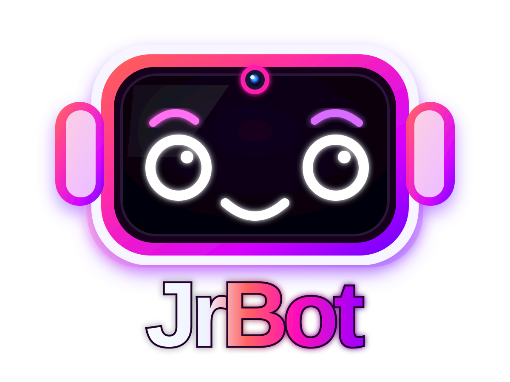

# JrBot

**Open-source Physical AI Robot powered by ESP32-S3**  
See. Hear. Speak. Connect. Express.

[Website](https://jrbot.com.br) ·
[Build your own](#build-your-own-jrbot) ·
[JrSkill Network](#jrskill-network--the-jrbot-skills-ecosystem) ·
[Documentation](docs/README.md) ·
[Roadmap](docs/01-history-roadmap/ROADMAP.md) ·
[Contribute](CONTRIBUTING.md)

  

## AI is leaving the screen.

[Watch JrBot in action — Instagram Reel](https://www.instagram.com/reel/Ddpiov9N8Ts/?obrf=MWN5Mmw0ZGZzazk4Zg==)

Most AI assistants live inside a browser, phone or computer. **JrBot explores what happens when AI has a physical presence.**

JrBot is an open-source ESP32-S3 robot with a camera, microphone, speaker, expressive OLED face, local connectivity and real-time audio/video. Its hardware foundation supports future voice, intelligence and portable Skills.

> **JrBot was not created only to answer. It was created to be there.**

## What JrBot does

| Capability | Implemented features |
| --- | --- |
| **See** | OV5640 photos, browser preview and Live JPEG video; QVGA/VGA/SVGA, image quality and FPS controls |
| **Hear** | MS3625 I2S recording, selectable duration, WAV playback/download and bidirectional WebRTC audio |
| **Speak** | MAX98357A output, speaker playback, audio received from phone/computer, volume and diagnostics |
| **Express** | SSD1306 OLED face with selectable expressions and active-expression status |
| **Connect** | Wi-Fi (DHCP, saved configuration and reconnection), responsive web interface, local HTTPS and WebRTC |
| **Interact** | Direct browser control on the local network, including Live with independent audio-direction mute |

### What's new in JrBot V1.8S

**JrBot V1.8S** retains all the capabilities listed above and introduces **JrSkill Network** integration. Users can acquire Skills through the platform, manage their licenses and execute them directly on JrBot.

The initial Creator Studio, Store, licensing and Skill execution flow have been completed and validated. **An expanded platform for developing and publishing Skills is now under development**, offering new possibilities for creators and developers.

### Current limitations

Live communication currently works on the local network. Remote Internet connectivity and audio/video improvements remain planned for future versions. See [Testing](docs/04-firmware-development/TESTING.md) and [Project status](docs/01-history-roadmap/PROJECT_STATUS.md).

## Build your own JrBot

JrBot is designed so technology enthusiasts can build their own robot using **widely available, off-the-shelf electronic components**.

At its heart is an **ESP32-S3 CAM (N16R8)** board with an **OV5640 camera**. It uses the familiar **MS3625 microphone** and **MAX98357A audio amplifier** for sound, while a small **SSD1306 OLED display** brings its expressions to life.

**Want to build your own JrBot?** Explore the [parts list](docs/02-assembly/BILL_OF_MATERIALS.md), [wiring reference](docs/02-assembly/WIRING.md), and [assembly guide](docs/02-assembly/ASSEMBLY_GUIDE.md).

## JrSkill Network — The JrBot Skills Ecosystem

**JrSkill Network** extends JrBot with a way to discover, acquire and execute new robot abilities, called **Skills**. Users can browse Skills, connect a Solana wallet, manage their licenses and run supported actions on their own JrBot.

### How it works

The ecosystem connects four parts:

1. **Creator Studio** — the initial, validated interface for creating and publishing structured Skills; its developer tools are being expanded.
2. **JrSkill Store** — a place to discover Skills and acquire licenses using a Solana wallet such as Phantom.
3. **Solana + JrBot Cloud** — the licensing, transaction and verification layer, currently validated on **Solana Devnet**.
4. **My Skills on JrBot** — the robot's interface for finding licensed Skills and executing supported actions through its controlled runtime.

~~~text
Create a Skill → Publish to Store → Acquire a license
        → My Skills → Execute on JrBot
~~~

Skills run through approved robot operations rather than unrestricted access to hardware or native code. **The existing creation and publishing flow is operational on Devnet; the expanded developer platform is the next development stage.**

### Developed during Colosseum 2026

**JrSkill Network began as a major JrBot upgrade during the Colosseum / Crypto World's Fair 2026 hackathon** and is now part of **JrBot V1.8S**. During the event, we completed and validated the entire flow on Solana Devnet: creating and publishing Skills, acquiring licenses through the Store and executing a licensed Skill on a physical JrBot. The independent test Skill `jrteste` was successfully executed on the robot.

That first stage is complete. Work now continues on expanding the Skill development and publishing platform. **Devnet validation is not a claim of a live Solana Mainnet marketplace.**

**Want to see how we built JrSkill Network?** Follow the complete [Colosseum 2026 development diary — Kickoff and Day 1–9](docs/06-colosseum-history/HACKATHON_DEVLOG.md), including tests, screenshots and physical validation.

[Explore the JrSkill Store](https://jrbot.com.br/en/store/) · [JrSkill technical documentation](docs/05-jrskill-network/JRSKILL_API.md) · [Colosseum project](https://colosseum.com/arena/projects/jrskill-network)

## Project status and roadmap

**JrBot V1.8S** is the defined next version of JrBot, combining all existing robot capabilities with **JrSkill Network**. The robot functions and the Solana Devnet flow for acquiring, licensing and executing Skills have been validated. The `V1s-00` branch is being prepared for promotion to `main`.

| Project | Status |
| --- | --- |
| **JrBot V1.8S** | Integrated robot and JrSkill capabilities; preparing the official release |
| **JrSkill development platform** | Expanding tools for creators to develop and publish new Skills |
| **JrBot V2** | Local voice control — future development |
| **JrBot V3** | Programmatic control and Runtime API evolution — planned |
| **JrBrain** | Memory, personality, context and AI — future vision |

Explore the full [project roadmap](docs/01-history-roadmap/ROADMAP.md). The [Colosseum 2026 development diary](docs/06-colosseum-history/HACKATHON_DEVLOG.md) preserves the history of the JrSkill upgrade.

## Contributing and documentation

JrBot welcomes contributions in ESP32-S3 firmware, hardware, audio/WebRTC, camera, frontend, AI, Solana, testing and documentation. You do not need to own a complete robot to contribute.

Start with the [Contribution Guide](CONTRIBUTING.md) and [open Issues](https://github.com/JuniorNarciso26/JrRobot/issues). Describe the change, evidence and any missing physical tests in a Pull Request.

**Documentation:** [Index](docs/README.md) · [Architecture](docs/04-firmware-development/ARCHITECTURE.md) · [Development](docs/04-firmware-development/DEVELOPMENT.md) · [Testing](docs/04-firmware-development/TESTING.md) · [Runtime API](docs/04-firmware-development/API_RUNTIME.md) · [Changelog](docs/01-history-roadmap/CHANGELOG.md)

## License

Original repository content is released under the [MIT License](LICENSE), unless explicitly stated otherwise. Third-party components retain their own licenses. The MIT License does not grant rights to the **JrBot** trademark or authorize presenting derivative products as official JrBot products.

## Vision

**JrBot connects physical presence with a future ecosystem of portable abilities.** The goal is a robot that can listen, perceive, respond and gain new Skills without losing control of its hardware.

  <strong>JrBot</strong> 
  Listen. Understand. Respond. React. Express.  
  <em>Project by JrTk Invest</em>

---

  If you want to follow the evolution of open-source physical AI, consider starring the repository.

