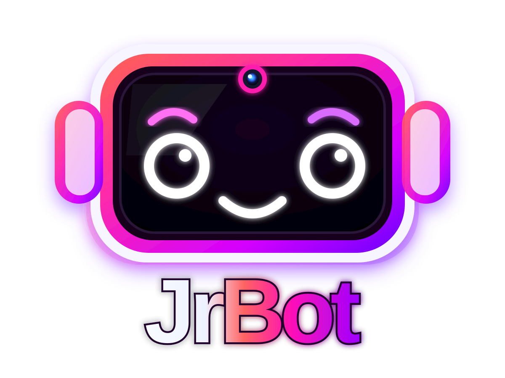

# JrBot

**Open-source Physical AI Robot powered by ESP32-S3**  
See. Hear. Speak. Connect. Express.

[Website](https://jrbot.com.br) ·
[Build your own](#build-your-own-jrbot) ·
[JrSkill Network](#jrskill-network--the-jrbot-skills-ecosystem) ·
[Documentation](docs/README.md) ·
[Roadmap](docs/01-history-roadmap/ROADMAP.md) ·
[Contribute](CONTRIBUTING.md)

  

## AI is leaving the screen.

[Watch JrBot in action — Instagram Reel](https://www.instagram.com/reel/Ddpiov9N8Ts/?obrf=MWN5Mmw0ZGZzazk4Zg==)

Most AI assistants live inside a browser, phone or computer. **JrBot explores what happens when AI has a physical presence.**

JrBot is an open-source ESP32-S3 robot with a camera, microphone, speaker, expressive OLED face, local connectivity and real-time audio/video. Its hardware foundation supports future voice, intelligence and portable Skills.

> **JrBot was not created only to answer. It was created to be there.**

## What JrBot does

| Capability | Implemented features |
| --- | --- |
| **See** | OV5640 photos, browser preview and Live JPEG video; QVGA/VGA/SVGA, image quality and FPS controls |
| **Hear** | MS3625 I2S recording, selectable duration, WAV playback/download and bidirectional WebRTC audio |
| **Speak** | MAX98357A output, speaker playback, audio received from phone/computer, volume and diagnostics |
| **Express** | SSD1306 OLED face with selectable expressions and active-expression status |
| **Connect** | Wi-Fi (DHCP, phone setup and up to four saved networks), automatic saved-profile failover and strong-signal AP selection, bounded idle-only low-RSSI roaming, Wi-Fi dashboard (SSID, IP, RSSI and channel), manual network scan, profile selection/deletion, `jrbot.local` on compatible local networks, local HTTPS and WebRTC |
| **Interact** | Direct browser control on the local network, including Live with independent audio-direction mute |

### What's new in JrBot V1.8S

**JrBot V1.8S** retains all the capabilities listed above and introduces **JrSkill Network** integration. Users can acquire Skills through the platform, manage their licenses and execute them directly on JrBot.

The initial Creator Studio, Store, licensing and Skill execution flow have been completed and validated. **An expanded platform for developing and publishing Skills is now under development**, offering new possibilities for creators and developers.

**V1.8.1S** improves Wi-Fi setup: JrBot opens its own setup network when it cannot connect at startup, tests new credentials before saving, and retries local `jrbot.local` announcement after an mDNS startup failure. On October 26, 2026, the project owner confirmed that the current physical tests passed and memory testing was completed. This confirmation does not provide new per-scenario logs or memory measurements.

**JrBot V1.8.4S** extends Wi-Fi reliability: automatic selection of a compatible access point with stronger signal at connection time; retry/failover across saved profiles; a one-time automatic reboot during startup recovery before opening phone setup; and lightweight Serial diagnostics. An ESP-IDF native low-RSSI event (threshold **-70 dBm**) may trigger a scan of the current SSID **only while idle**, with a controlled reconnection when a different access point offers at least **12 dB more signal** (minimum **90 seconds** between scans). No continuous scan task runs, and preventative roaming is suppressed during Live/recording. These policies were designed for generic customer networks, not tuned to a particular company.

### JrBot V1.8.4S: More reliable Wi-Fi (current main)

- **Better AP selection:** the ESP-IDF driver checks all Wi-Fi channels and prefers the strongest compatible access point for the selected SSID when connecting, including on reconnection; no fixed BSSID.
- **Recovery across networks:** up to four saved Wi-Fi profiles with bounded retries and automatic fallback, remembering a working alternative. One bounded boot-only restart helps recover when the initial setup times out; captive phone setup remains available.
- **Low-signal protection:** the native ESP-IDF RSSI event at **-70 dBm** triggers a same-SSID scan **only in idle mode**. Switching requires at least **12 dB** improvement over the current access point and scans are rate-limited to **90 seconds** apart. This is application-managed reconnect, not seamless 802.11 roaming. Video/audio sessions are never deliberately interrupted for a preventive scan.
- **Diagnostics:** Serial logs include real connected SSID/BSSID, signal, Wi-Fi disconnection reasons, reconnection attempts, internal RAM/PSRAM samples and failing HTTP routes (without exposing Wi-Fi passwords).
- **Hardware evidence:** in a short ESP32-S3 HW04 test, the robot selected the stronger of two `CPGAS_5G` access points (~-42 versus -82 dBm), remained connected with **zero recorded Wi-Fi disconnects**, and completed a WebRTC session. The low-signal roaming path was **not** triggered in that test. Independent full ESP-IDF build/regression and long-running reliability validation were **not** recorded. HTTPS TLS alerts and WebRTC video-buffer/memory pressure remain known issues.

The ESP32-S3 has **2.4 GHz Wi-Fi only**; an SSID containing “5G” does not indicate a 5 GHz radio link. See [Wi-Fi dashboard and roaming details](docs/04-firmware-development/WIFI_DASHBOARD.md) and [Project status](docs/01-history-roadmap/PROJECT_STATUS.md).

### JrBot V1.8.2S: Mesa Mix for Live audio

**JrBot V1.8.2S** introduced **Mesa Mix · Live**, which lets users adjust WebRTC speaker volume, microphone gain, echo ducking, noise gate and pre-buffer in the robot's web page. Settings apply during the Live and reset when the robot restarts. The owner reports good communication with headphones and improved sound after lowering microphone gain and speaker volume. A delayed return of their own voice remains under investigation; no RAM/PSRAM time series were supplied for this version. See the [Mesa Mix guide](docs/04-firmware-development/LIVE_AUDIO_LAB.md).

### JrBot V1.8.3S: Wi-Fi dashboard after first setup

**JrBot V1.8.3S** is the previous source release. The robot's local page, `https://jrbot.local`, now has **Control · Memory · Wi-Fi** tabs. The Wi-Fi tab shows whether the robot is connected, the current network (SSID), assigned IP, signal strength (RSSI in dBm), Wi-Fi channel and current operating mode. You can refresh the signal on demand or optionally every 10 seconds while the tab is visible.

When the robot is idle, you can scan nearby networks (up to eight displayed), save a new network or update a saved profile, view up to four saved networks, select which one to use next, and **delete a saved network** with confirmation. Changing the selected network does **not** interrupt the active connection immediately: applying it requires a separate, confirmed reboot. Deleting the selected profile warns that first-time setup may be required at the next boot.

The existing first-run phone setup remains available when the robot cannot connect. Network changes use a dedicated **HTTPS-only** local endpoint; the ordinary HTTP command route still rejects Wi-Fi commands. **This panel does not yet implement user authentication and must not be exposed directly to the public Internet.** The new release is integrated in source control; compile/runtime memory and full hardware regression metrics have not been independently verified in this documentation update.

See [Wi-Fi dashboard guide](docs/04-firmware-development/WIFI_DASHBOARD.md), [Installation](docs/04-firmware-development/DEVELOPMENT.md) and [Project status](docs/01-history-roadmap/PROJECT_STATUS.md).

### Current limitations

Live communication currently works on the local network. Remote Internet connectivity and audio/video improvements remain planned for future versions. See [Testing](docs/04-firmware-development/TESTING.md) and [Project status](docs/01-history-roadmap/PROJECT_STATUS.md).

## Build your own JrBot

JrBot is designed so technology enthusiasts can build their own robot using **widely available, off-the-shelf electronic components**.

At its heart is an **ESP32-S3 CAM (N16R8)** board with an **OV5640 camera**. It uses the familiar **MS3625 microphone** and **MAX98357A audio amplifier** for sound, while a small **SSD1306 OLED display** brings its expressions to life.

**Want to build your own JrBot?** Explore the [parts list](docs/02-assembly/BILL_OF_MATERIALS.md), [wiring reference](docs/02-assembly/WIRING.md), and [assembly guide](docs/02-assembly/ASSEMBLY_GUIDE.md).

## JrSkill Network — The JrBot Skills Ecosystem

**JrSkill Network** extends JrBot with a way to discover, acquire and execute new robot abilities, called **Skills**. Users can browse Skills, connect a Solana wallet, manage their licenses and run supported actions on their own JrBot.

### How it works

The ecosystem connects four parts:

1. **Creator Studio** — the initial, validated interface for creating and publishing structured Skills; its developer tools are being expanded.
2. **JrSkill Store** — a place to discover Skills and acquire licenses using a Solana wallet such as Phantom.
3. **Solana + JrBot Cloud** — the licensing, transaction and verification layer, currently validated on **Solana Devnet**.
4. **My Skills on JrBot** — the robot's interface for finding licensed Skills and executing supported actions through its controlled runtime.

~~~text
Create a Skill → Publish to Store → Acquire a license
        → My Skills → Execute on JrBot
~~~

Skills run through approved robot operations rather than unrestricted access to hardware or native code. **The existing creation and publishing flow is operational on Devnet; the expanded developer platform is the next development stage.**

### Developed during Colosseum 2026

**JrSkill Network began as a major JrBot upgrade during the Colosseum / Crypto World's Fair 2026 hackathon** and is now part of **JrBot V1.8S**. During the event, we completed and validated the entire flow on Solana Devnet: creating and publishing Skills, acquiring licenses through the Store and executing a licensed Skill on a physical JrBot. The independent test Skill `jrteste` was successfully executed on the robot.

That first stage is complete. Work now continues on expanding the Skill development and publishing platform. **Devnet validation is not a claim of a live Solana Mainnet marketplace.**

**Want to see how we built JrSkill Network?** Follow the complete [Colosseum 2026 development diary — Kickoff and Day 1–9](docs/06-colosseum-history/HACKATHON_DEVLOG.md), including tests, screenshots and physical validation.

[Explore the JrSkill Store](https://jrbot.com.br/en/store/) · [JrSkill technical documentation](docs/05-jrskill-network/JRSKILL_API.md) · [Colosseum project](https://colosseum.com/arena/projects/jrskill-network)

## Project status and roadmap

**JrBot V1.8S** integrated the existing robot capabilities with **JrSkill Network**. The earlier Solana Devnet flow for acquiring, licensing and executing Skills was validated on its recorded build. **V1.8.1S** added phone-based Wi-Fi setup and mDNS recovery; the project owner reported physical tests OK and memory testing complete on October 26, 2026. **V1.8.2S** added the Live audio Mesa Mix, promoted from the tested `AUDIO_LAB_01` branch with the delayed voice return documented as a known limitation. **V1.8.3S** added the connected-mode Wi-Fi dashboard, manual signal/network inspection and saved-network management, including selection and confirmed deletion. **V1.8.4S** adds the stronger-AP selection, saved-profile recovery, limited idle-only roaming and diagnostic logging described above.

| Project | Status |
| --- | --- |
| **JrBot V1.8S** | Integrated robot and JrSkill capabilities; preparing the official release |
| **JrSkill development platform** | Expanding tools for creators to develop and publish new Skills |
| **JrBot V2** | Local voice control — future development |
| **JrBot V3** | Programmatic control and Runtime API evolution — planned |
| **JrBrain** | Memory, personality, context and AI — future vision |

Explore the full [project roadmap](docs/01-history-roadmap/ROADMAP.md). The [Colosseum 2026 development diary](docs/06-colosseum-history/HACKATHON_DEVLOG.md) preserves the history of the JrSkill upgrade.

## Contributing and documentation

JrBot welcomes contributions in ESP32-S3 firmware, hardware, audio/WebRTC, camera, frontend, AI, Solana, testing and documentation. You do not need to own a complete robot to contribute.

Start with the [Contribution Guide](CONTRIBUTING.md) and [open Issues](https://github.com/JuniorNarciso26/JrRobot/issues). Describe the change, evidence and any missing physical tests in a Pull Request.

**Documentation:** [Index](docs/README.md) · [Wi-Fi Dashboard](docs/04-firmware-development/WIFI_DASHBOARD.md) · [Architecture](docs/04-firmware-development/ARCHITECTURE.md) · [Development](docs/04-firmware-development/DEVELOPMENT.md) · [Testing](docs/04-firmware-development/TESTING.md) · [Runtime API](docs/04-firmware-development/API_RUNTIME.md) · [Changelog](docs/01-history-roadmap/CHANGELOG.md)

## License

Original repository content is released under the [MIT License](LICENSE), unless explicitly stated otherwise. Third-party components retain their own licenses. The MIT License does not grant rights to the **JrBot** trademark or authorize presenting derivative products as official JrBot products.

## Vision

**JrBot connects physical presence with a future ecosystem of portable abilities.** The goal is a robot that can listen, perceive, respond and gain new Skills without losing control of its hardware.

  <strong>JrBot</strong> 
  Listen. Understand. Respond. React. Express.  
  <em>Project by JrTk Invest</em>

---

  If you want to follow the evolution of open-source physical AI, consider starring the repository.

